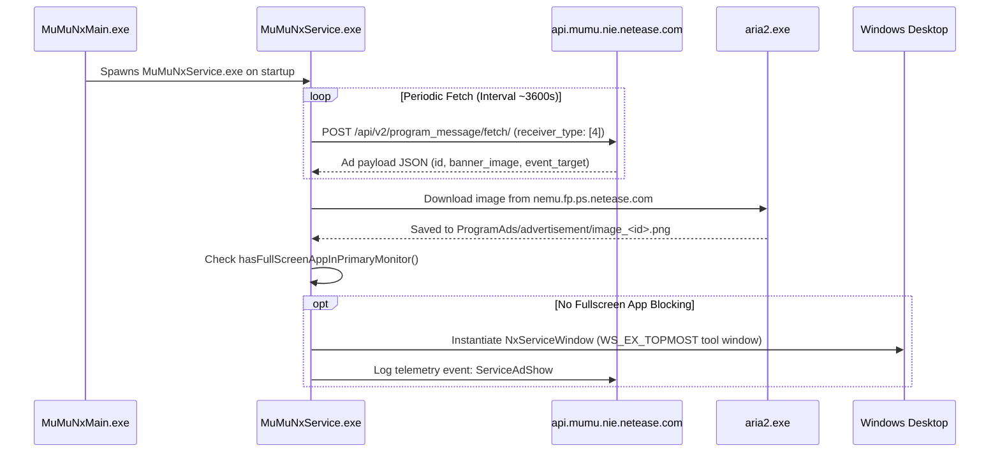

# MuMu 12 Desktop Ad Banner (`MuMuNxService.exe`) Reverse Engineering & Neutralization

## 1. Overview & Problem Description

Even after stripping guest-side Android adware and replacing the launcher, a persistent floating banner advertisement can appear directly on the Windows desktop in the bottom-right corner. 

This banner hovers above the taskbar, remains top-most (`WS_EX_TOPMOST`), and persists even when the main emulator UI ([`MuMuNxMain.exe`](file:///D:/Program%20Files/Netease/MuMu%20Player%2012/nx_main/MuMuNxMain.exe)) is minimized.

This document details the reverse engineering investigation that identified the origin, process hierarchy, network trigger, caching mechanism, and window properties of this banner, along with instructions to permanently neutralize it.

---

## 2. Process & Window Architecture

Runtime inspection of desktop windows on the Windows interactive station (`WinSta0\Default`) revealed the exact window and host process:

| Property | Value | Description |
| :--- | :--- | :--- |
| **Host Executable** | [`MuMuNxService.exe`](file:///D:/Program%20Files/Netease/MuMu%20Player%2012/nx_main/MuMuNxService.exe) | Background service launched by `MuMuNxMain.exe` |
| **Installation Path** | `<MUMU_DIR>\nx_main\MuMuNxService.exe` | Default `D:\Program Files\Netease\MuMu Player 12\nx_main\` |
| **Window Class** | `Qt5156QWindowToolSaveBits` | Qt5 tool window with saved bits backing store |
| **Internal C++ Classes** | `NxServiceWindow`, `NxServiceView` | Discovered via RTTI symbols in `MuMuNxService.exe` |
| **Presenter Class** | `NxServicePresenterImpl` | Controls message polling, download callbacks, and rendering |
| **Window Styles** | `0x960A0000` | `WS_POPUP \| WS_VISIBLE \| WS_CLIPSIBLINGS \| WS_CLIPCHILDREN` |
| **Extended Styles** | `0x80080` | `WS_EX_TOPMOST \| WS_EX_TOOLWINDOW` |
| **Desktop Placement** | Rect `(2153, 1151)` to `(2553, 1385)` | 400×234 logical px (600×351 physical at 150% scaling) |
| **Placement Anchor** | Screen bottom-right | Floats immediately above the Windows taskbar |

### Associated Child Processes
* **`aria2.exe`**: `<MUMU_DIR>\nx_main\aria2.exe` (spawned with RPC port and secret to stream banner assets).
* **`crashpad_handler.exe`**: Sentry crash and diagnostic event reporter.

---

## 3. Remote Delivery & Display Flow



### Decrypted Cloud Payload
When `MuMuNxService.exe` calls `https://api.mumu.nie.netease.com/api/v2/program_message/fetch/`, the server returns:
```json
{
  "errcode": 100,
  "errmsg": "ok",
  "data": {
    "id": "6ad2016e2c03f0badd2f652b",
    "title": "",
    "content": "",
    "pop_way": 1,
    "display_type": 2,
    "banner_image": "https://nemu.fp.ps.netease.com/file/6ad201484b8fd58ee63d4717oQxJQ5Kp07",
    "flicker_image": "",
    "event_type": 2,
    "event_target": {
      "url": "mumu://store/wechat_mini_game?fromid=6ad2016e2c03f0badd2f652b&from=%E5%B0%8F%E7%A8%8B%E5%BA%8F"
    },
    "msg_type": 1,
    "receiver_type": [4],
    "sv": 0
  }
}
```

### Fullscreen Detection Logic
Inspection of strings in `MuMuNxService.exe` revealed that the banner checks the primary monitor state before popping up:
* `NxServiceWindow::hasFullScreenAppInPrimaryMonitor`: Queries top-level visible window bounds against display bounds.
* If a game or video player is running fullscreen, display is temporarily suppressed; once in desktop mode, `NxServiceWindow::showWin` renders the banner.

---

## 4. Multi-Layered Neutralization Guide

### Layer 1: Immediate Process Termination
To instantly dismiss an active banner without closing your running Android 15 instance:
```powershell
Stop-Process -Name MuMuNxService -Force
```
*(The emulator VM `MuMuNxDevice.exe` runs independently and is unaffected).*

### Layer 2: Automated Debloater Integration
[`mumu_debloater.ps1`](file:///F:/projects/personal/mumu/mumu_debloater.ps1) automatically purges `ProgramAds\advertisement`, locks `programAds.json`, and terminates `MuMuNxService`.

### Layer 3: Host-Level Ad Cache Lockdown
Prevent `aria2.exe` from writing new image assets to disk:
```powershell
$adDir = "$env:APPDATA\Netease\MuMuPlayer\data\ProgramAds"
if (Test-Path $adDir) {
    Remove-Item -Recurse -Force "$adDir\*"
    icacls "$adDir\advertisement" /deny Everyone:(OI)(CI)(W,D)
}
```

### Layer 4: Windows Host DNS Sinkhole
Add the ad delivery and asset endpoints to your Windows host hosts file (`C:\Windows\System32\drivers\etc\hosts`) in addition to the guest Android hosts:
```text
# NetEase MuMu Windows Host Ad Blocking
0.0.0.0 api.mumu.nie.netease.com
0.0.0.0 nemu.fp.ps.netease.com
0.0.0.0 sentry.netease.com
```
